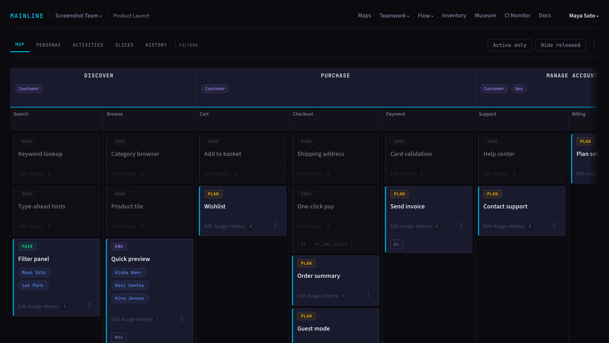
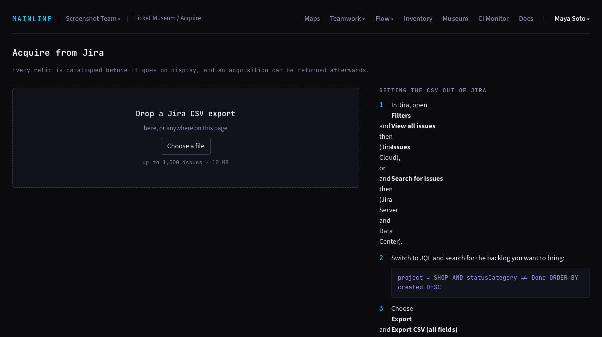

# Mainline

Open-source project management for continuous delivery teams. A Jira alternative built for small, frequent, safe releases. Works with or without coding agents.

Mainline is project tooling for teams that practise continuous integration and continuous delivery. Work lives on a user story map instead of a backlog: activities across the top, releases sliced down in priority order. Each person has one active story at a time, enforced by the system. A team can raise its limit, and the change is an event everyone sees. Deploy and release are separate events with separate buttons, so nothing is called done until users have it. There are no story points, no sprints and no individual metrics. Every change is an immutable event and the whole team sees the same views: the map, flow, teamwork and inventory. The CI Monitor shows how long each branch has lived on every connected GitHub repo.



Bring a Jira backlog in from a CSV export. It lands in the Ticket Museum, frozen, and you promote what's worth building onto the map one story at a time, rewritten with its acceptance scenarios. A specification or research comes in the same way: a model writes a Mainline file of small proposed stories, checked against [a published schema](public/schemas/import-1.json), and each one waits in the museum for a person to promote it.

Everything a team has can be downloaded again as one zip, by any member: the stories in map order with a Gherkin feature file each, a CSV that Jira's importer reads, the museum, and the full record as JSON described by [a published schema](public/schemas/export-1.json).



Documentation and practice guides: https://mainline.dev/docs

Mainline was developed privately before this public release. The hosted service at https://mainline.dev runs this same code.

## Quick start

You need Docker with Compose.

```shell
git clone https://github.com/mainline-dev/mainline-core.git
cd mainline-core
docker compose up --build
```

The app runs at http://localhost:3000. `docker-compose.yml` is the development setup and carries its own throwaway values, so no configuration is needed.

For sample teams, seed the empty database before signing up. It writes a login link for each person to `tmp/dev_seed.txt`:

```shell
docker compose exec app bundle exec rake dev_seed
```

To start from nothing instead, sign up with an email address. Development sends no mail, so it doesn't ask you to verify the address. The Google, GitHub and GitLab buttons appear once their variables hold real OAuth apps.

## Self-host

`docker-compose.selfhost.yml` runs the app, a Sidekiq worker, Postgres and Redis with `RACK_ENV=production`. Every variable is required and has no default. Set them in your shell, or in a `.env` file next to the compose file, then:

```shell
docker compose -f docker-compose.selfhost.yml up -d
```

This pulls the published image, `ghcr.io/mainline-dev/mainline-core`. To run your own checkout instead, add `--build`.

| Variable | Purpose |
|---|---|
| `POSTGRES_PASSWORD` | Password for the `mainline` database owner |
| `MAINLINE_APP_USER_DATABASE_PASSWORD` | Password for the `mainline_app` role the app connects as (row-level security applies to it) |
| `MAINLINE_SESSION_SECRET` | Session cookie secret, at least 64 random characters (`openssl rand -hex 32`) |
| `LOCKBOX_MASTER_KEY` | 64 hex characters used to encrypt email addresses at rest (`openssl rand -hex 32`) |
| `BASE_URL` | Public URL of the app, for example `https://mainline.example.org` |
| `SIGNUPS` | `open` lets anyone sign up. Anything else lets in only the first person and people with an invite |
| `MAINLINE_HOST` | Host name of the app, for example `mainline.example.org` |
| `SMTP_HOST` | Mail server host name |
| `SMTP_PORT` | Mail server port, usually 587 |
| `SMTP_USERNAME` | Mail server user name |
| `SMTP_PASSWORD` | Mail server password |
| `SMTP_TLS` | `starttls` (port 587) or `tls` (encrypted from the start, port 465) |
| `MAIL_FROM` | Sender for all email, for example `Mainline <noreply@example.org>` |
| `CI_MONITOR_GITHUB_APP_ID` | CI Monitor GitHub App ID |
| `CI_MONITOR_GITHUB_APP_SLUG` | CI Monitor GitHub App URL name, used for the install link |
| `CI_MONITOR_GITHUB_APP_CLIENT_ID` | CI Monitor GitHub App client ID |
| `CI_MONITOR_GITHUB_APP_CLIENT_SECRET` | CI Monitor GitHub App client secret |
| `CI_MONITOR_GITHUB_PRIVATE_KEY` | CI Monitor GitHub App private key (PEM) |
| `CI_MONITOR_GITHUB_WEBHOOK_SECRET` | CI Monitor GitHub App webhook signing secret |
| `SENTRY_DSN` | Sentry DSN for error reports; a plain word such as `disabled` turns sending off |
| `SENTRY_ENVIRONMENT` | Label on error reports, for example `production` |

### Sign-in providers

Email accounts always work. Each provider below adds its button to the login and sign-up pages once its client ID and secret hold a real OAuth app. Set both to `disabled` to leave that provider out.

| Variable | Purpose |
|---|---|
| `GOOGLE_CLIENT_ID` | Google OAuth client ID, or `disabled` |
| `GOOGLE_CLIENT_SECRET` | Google OAuth client secret, or `disabled` |
| `GH_OAUTH_CLIENT_ID` | GitHub OAuth app client ID, or `disabled` |
| `GH_OAUTH_CLIENT_SECRET` | GitHub OAuth app client secret, or `disabled` |
| `GITLAB_CLIENT_ID` | GitLab application ID, or `disabled` |
| `GITLAB_CLIENT_SECRET` | GitLab application secret, or `disabled` |

### HTTPS and public installs

The app listens on `127.0.0.1:3000` and needs HTTPS in front of it, because session cookies in production are HTTPS only. Caddy fetches a certificate for you. With your domain pointing at the server, install Caddy there and put this in its `Caddyfile`:

```
mainline.example.org {
    reverse_proxy 127.0.0.1:3000
}
```

Set `BASE_URL` to `https://mainline.example.org` and `MAINLINE_HOST` to `mainline.example.org`.

Set `SIGNUPS=closed` on anything reachable from the internet, and sign up as soon as it starts, because the first person to sign up gets in. After that, people need an invitation. New email accounts verify their address before creating a team, so SMTP has to work.

## Running the tests

The suite runs inside Docker. With the development stack up:

```shell
scripts/test.sh
```

It migrates the test database, runs RuboCop, then the model and acceptance tests in Docker, then the browser tests on the host (they need Chrome).

## Licence

Copyright (C) 2026 Kipple Pty Ltd.

GNU Affero General Public License v3.0. See [LICENSE](LICENSE).

Mainline™ is a trademark of Kipple Pty Ltd. The licence covers the code, not the name.
