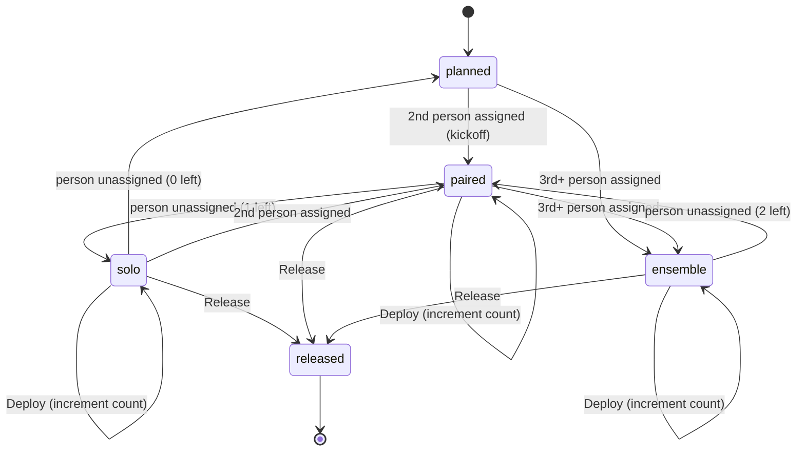

# Story State Machine

## States

| State | Assignees | Status | How you get here |
|-------|-----------|--------|------------------|
| planned | 0-1 | planned | Story created, or everyone unassigned |
| paired | 2 | active | 2nd person assigned — this is the kickoff |
| ensemble | 3+ | active | 3rd+ person assigned |
| solo | 1 | active | Started as pair/ensemble, others left |
| released | any | released | Release action — terminal |

## Rules

- **Work starts with 2+ people (by default).** The kickoff is a team act. Exception: a single-member team, or a team with `allow_solo_activation` enabled, can activate a story with 1 person.
- **Solo is a consequence, not a choice (on multi-person teams).** You can only reach solo by starting as a pair/ensemble and having people leave. It's surfaced visually (red) so the team can see it and offer help.
- **1 assigned but planned** is valid — someone is queued up but work hasn't started (unless solo activation is allowed).
- **Unassign to 0** always reverts to planned.
- **Deploy** can happen many times while active. Increments `deploy_count`, updates `last_deployed_at`. Not a state change.
- **Released** is the terminal state.

## Implementation note

The database has three statuses: `planned`, `active`, `released`. The collaboration modes (paired, ensemble, solo) are derived from the assignment count and recorded as events (`collaboration_changed`), not stored as a DB column.
