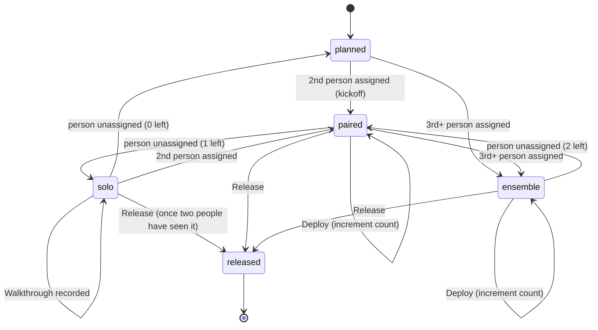

# Story State Machine

## States

| State | Assignees | Status | How you get here |
|-------|-----------|--------|------------------|
| planned | 0-1 | planned | Story created, or everyone unassigned |
| paired | 2 | active | 2nd person assigned - this is the kickoff |
| ensemble | 3+ | active | 3rd+ person assigned |
| solo | 1 | active | Started by one person where the team allows it, or others left a pair or ensemble |
| awaiting walkthrough | 1 | active | Solo, deployed at least once, never had two people on it, no walkthrough recorded |
| released | any | released | Release action - terminal |

## Rules

- **Work starts with 2+ people (by default).** The kickoff is a team act. Exception: a single-member team, or a team with `allow_solo_activation` enabled, can activate a story with 1 person.
- **Solo is allowed where the team allows it, and a second person sees the story before release.** A solo story that has been deployed waits for a walkthrough. SOLO is grey where solo is allowed and red while the story waits. Teams that don't allow solo see it red throughout.
- **Two people see every story before release.** A story can be released once two people were on it at any time while it was active, or once a walkthrough is recorded. Teams of one are exempt. A team can turn the rule off in Settings, giving a reason.
- **A walkthrough** is recorded on the Walkthroughs page for an active story deployed at least once. One or more team members who aren't on the story attend. A story can be walked through more than once. A deploy after the latest walkthrough is flagged and doesn't block release.
- **The stories awaiting a walkthrough are limited** per team: 3 by default, from 1 to 10. At the limit, nobody can start another story.
- **Kickoff:** on a paired or ensemble story, the second person being assigned is the kickoff. On a solo story, someone other than the last person to change the scenarios agrees them. Kickoff is shown and never enforced.
- **1 assigned but planned** is valid - someone is queued up but work hasn't started (unless solo activation is allowed).
- **Unassign to 0** always reverts to planned.
- **Deploy** can happen many times while active. Increments `deploy_count`, updates `last_deployed_at`. Not a state change.
- **Released** is the terminal state.

## Implementation note

The database has three statuses: `planned`, `active`, `released`. The collaboration modes (paired, ensemble, solo) are derived from the assignment count and recorded as events (`collaboration_changed`), not stored as a DB column.

Walkthroughs (`walked_through`) and kickoffs (`scenarios_agreed`) are events on the story. No table holds them.
